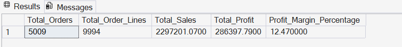
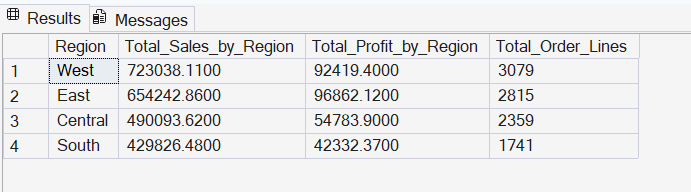
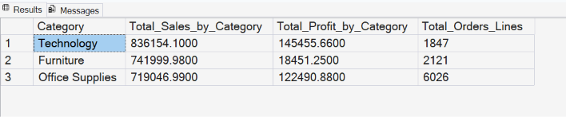
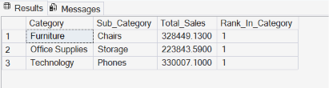
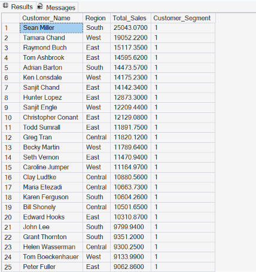
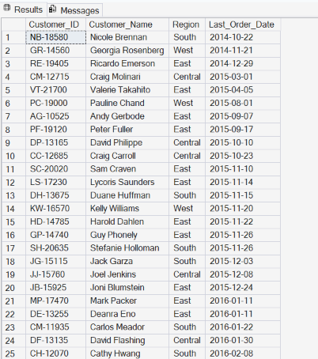
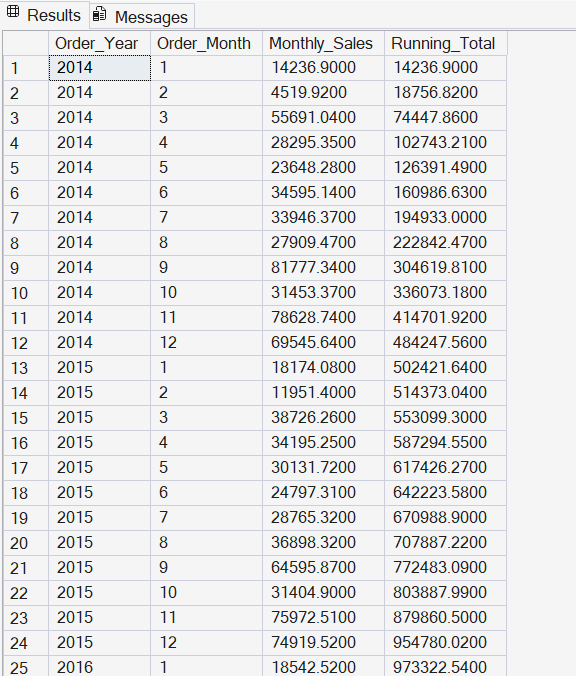
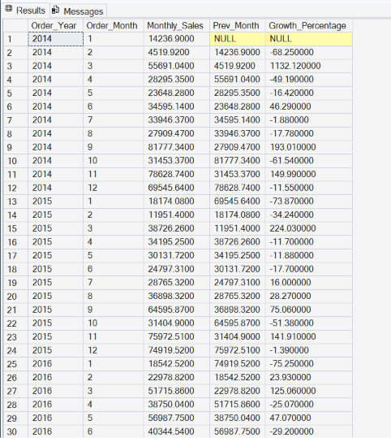

# Key Findings - Retail Sales Analytics

This document summarizes the important business insights obtained from the SQL analysis of the Superstore dataset.

---

## 1. Overall Business Performance

- Total Sales and Total Profit were calculated across all orders.
- The business shows positive overall profit, but margins vary significantly by category and region.

  
---

## 2. Regional Performance

- **West** and **East** regions generally contribute the highest sales.
- Some regions generate good sales but have lower profit margins.
- Regional performance helps identify where marketing and inventory efforts should be focused.

---

## 3. Category & Sub-Category Insights

- **Technology** is one of the most profitable categories.
- **Furniture** generates high sales but has lower profit margins in some sub-categories.
- Certain sub-categories are loss-making and need attention (possible over-discounting).

---

## 4. Customer Insights
- Top 10 customers contribute a significant portion of total sales.
- High-value customers are clearly identifiable using ranking and segmentation (NTILE).
- A group of customers have not placed any order recently and are at risk of churn.

---

## 5. Customers at Risk of Churn

- Customers whose last order was before 2017 are considered inactive.
- These customers can be targeted with re-engagement campaigns (discounts, emails, offers).

---

## 6. Time-based Trends
- Sales show clear monthly and yearly patterns.
- Month-over-Month growth is inconsistent — some months show strong growth while others decline.
- Running total of sales and profit helps track business momentum.

---

## 7. Key Recommendations

1. Focus marketing efforts on high-value customer segments.
2. Investigate loss-making products and review discount strategy.
3. Run re-engagement campaigns for customers at risk of churn.
4. Analyze high-performing regions and replicate successful strategies in weaker regions.
5. Monitor monthly growth more closely to reduce sales fluctuations.

---

## How These Insights Were Generated

All insights were derived using:
- JOINs
- CTEs
- Window Functions (ROW_NUMBER, RANK, LAG, NTILE, SUM OVER)
- Aggregations (SUM, AVG, COUNT)

